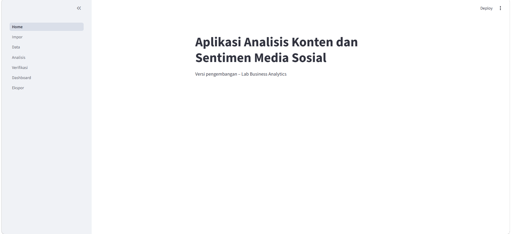
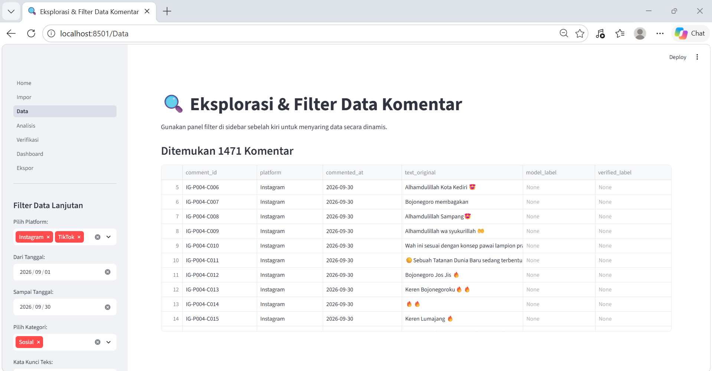
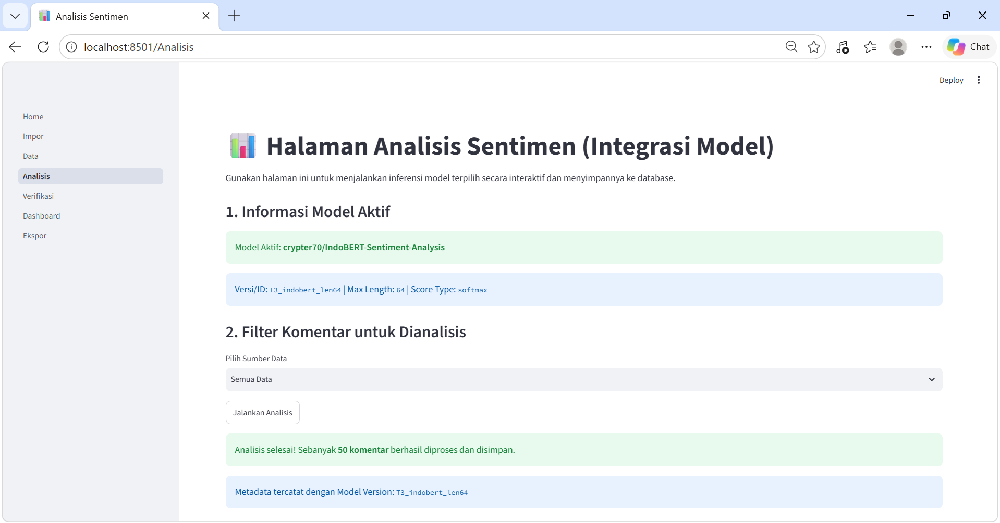
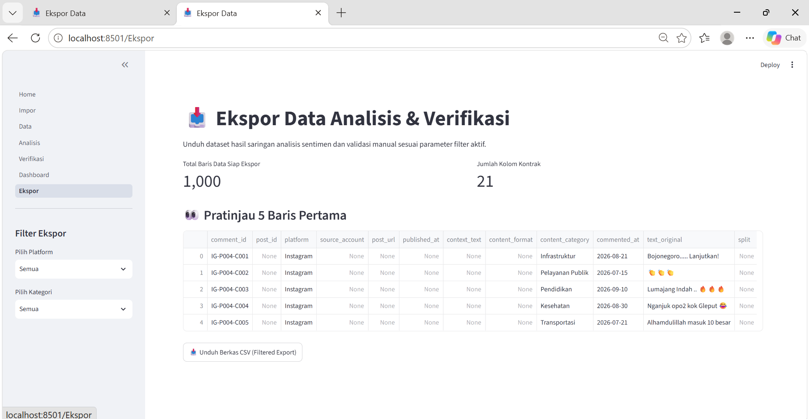

# Petunjuk Penggunaan Aplikasi Dashboard Analisis Sentimen & Kebijakan Publik

**Versi Dokumen:** 1.0 (Day 29 Release)  
**Penyusun:** Azzahra Attaqina

---

## 1. Persiapan dan Instalasi Singkat

Panduan ini dirancang untuk memandu pengguna dalam melakukan instalasi, menjalankan aplikasi, serta memanfaatkan seluruh modul fitur pada sistem Dashboard Analisis Sentimen dan Kebijakan Publik.

### A. Prasyarat Sistem

- Python versi 3.9 atau yang lebih baru.
- Pustaka utama yang dibutuhkan: `streamlit`, `pandas`, `sqlite3`, `scikit-learn`.

### B. Langkah Menjalankan Aplikasi

1. Buka terminal atau Command Prompt pada direktori kerja proyek (`magang-ba-2026`).
2. Aktifkan lingkungan virtual (_virtual environment_) jika Anda menggunakannya.
3. Jalankan perintah Streamlit berikut untuk meluncurkan antarmuka:
   ```bash
   streamlit run app/Home.py
   ```
4. Hasil: antarmuka aplikasi utama terbuka.
   

### C. Impor Data (Posts & Comments)

1. Buka menu Impor pada bilah sisi (sidebar) sebelah kiri aplikasi.
2. Unggah file dataset posts (format CSV/Excel) dan file comments v1.
3. Klik "Mulai Impor"
4. Sistem secara otomatis akan memvalidasi kolom ID dan menyaring baris kosong yang tidak valid.
5. Hasil: Muncul ringkasan data yang diterima (accepted) dan ditolak (rejected).
   .png>) .png>)

### D. Pemeriksaan Kualitas Data

1. Buka menu Data pada sidebar.
2. Tinjau tabel utama untuk memastikan kolom tanggal, teks asli, dan ID komentar terbaca dengan benar tanpa nilai kosong (NaN) yang krusial.
3. Hasil: Tabel interaktif menampilkan data bersih yang siap diolah ke tahap selanjutnya.
   

### E. Pencarian dan Filter Interaktif

1. Buka pada menu Data
2. Pada panel filter interaktif di sidebar, pilih platform (mis. Instagram, YouTube) atau kategori konten yang diinginkan.
3. Masukkan rentang tanggal yang ingin dicari.
4. Masukkan kata kunci tertentu pada kolom pencarian teks jika ingin mempersempit hasil.
5. Hasil: Tabel dan metrik langsung ter-update secara real-time menampilkan jumlah baris data sesuai filter aktif.
   

### F. Menjalankan Analisis Sentimen

1. Buka menu Analisis pada sidebar.
2. Pilih versi model inferensi yang tersedia di sebelah kiri (mis. T3_indobert_len64).
3. Klik tombol "Jalankan Analisis" dan tunggu hingga bilah kemajuan (progress bar) selesai memproses data layak.
4. Hasil: Akan menampilkan Kolom prediksi, skor keyakinan, jenis skor, dan versi model terisi ke dalam basis data.
   

### G. Verifikasi dan Koreksi Label

1. Buka menu Verifikasi pada sidebar.
2. Pilih ID komentar atau tinjau tabel ringkasan prediksi terbaru.
3. Isi formulir koreksi label (pilih label baru: positif/negatif/netral, masukkan ID reviewer, dan tuliskan alasan koreksi minimal 5 karakter).
4. Klik tombol "Simpan Koreksi".
5. Hasil: Riwayat perubahan tercatat secara permanen di tabel verification_history dan ditampilkan sebagai audit trail.
   .png>) .png>) .png>)

### H. Membaca Dashboard Analisis

1. Buka menu Dashboard pada sidebar.
2. Amati kartu metrik utama (Total Unggahan, Komentar Layak, Komentar Diprediksi, Komentar Terverifikasi, dan Persentase Verifikasi).
3. Analisis grafik visual pendukung (Grafik platform, kategori konten, distribusi sentimen, dan tren mingguan).
4. Hasil: Tinjauan komprehensif kondisi opini publik tersaji secara visual dan interaktif.
   .png>) .png>)

### I. Mengekspor Data

1. Buka menu Ekspor pada sidebar.
2. Sesuaikan filter data yang ingin diunduh (atau pilih opsi "Semua").
3. Klik tombol unduh laporan.
4. Hasil: File laporan berhasil diunduh ke perangkat lokal Anda.
   
